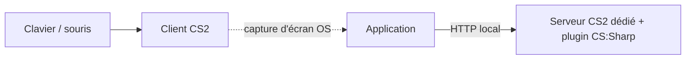

# Architecture technique — Logiciel de lineups CS2

Ce document complète `structure-donnees-lineups.md` (modèle de données) en couvrant l'architecture logicielle : quels processus tournent, avec quelles technologies, et comment ils communiquent.

## Vue d'ensemble

Trois processus séparés tournent sur la même machine Windows :



L'application ne contrôle jamais le personnage (ça reste au clavier/souris sur le client) et n'a aucun accès au rendu du serveur (qui n'en a pas). Elle a une relation étroite avec le serveur via son plugin, et une relation passive avec le client via la capture d'écran système.

## Composants de l'application

### 1. Fenêtre principale

- **Techno** : Python + `pywebview`
- **Contenu** : HTML/CSS/JS — reprend directement les maquettes déjà validées (navigation entre lineups, panneaux position/visée, formulaire de création)
- **Rôle** : consultation, édition détaillée, gestion de la bibliothèque de lineups
- **Pourquoi ce choix** : réutilise vos compétences Python/Django côté logique métier, et le HTML/CSS/JS déjà produit pour l'interface, sans introduire un framework UI supplémentaire (Qt, WinUI) à apprendre.

### 2. Panneau overlay (pendant la création en jeu)

- **Techno** : `pywebview`, fenêtre séparée de la fenêtre principale
- **Paramètres** : `frameless=True`, `on_top=True`, positionnée dans un coin de l'écran
- **Pas de transparence** : l'option `transparent` de `pywebview` n'est pas fiable sous Windows d'après sa documentation — le panneau reste un petit encart opaque plutôt qu'un overlay qui se fond dans le jeu
- **Contenu minimal** : statut de la dernière action (capturé / téléporté), rappel des raccourcis clavier
- **Ne se clique pas pendant le jeu** : c'est un affichage passif, l'action se déclenche au clavier (voir ci-dessous)

### 3. Raccourcis clavier globaux

- **Techno** : bibliothèque `keyboard`
- **Rôle** : déclencher capture/test sans voler le focus de la fenêtre CS2
- **Exemple** :
  ```python
  import keyboard
  keyboard.add_hotkey('f9', declencher_capture)
  keyboard.add_hotkey('f10', declencher_test)
  ```

### 4. Capture d'écran

- **Techno** : bibliothèque `mss`
- **Rôle** : capturer l'écran ou la fenêtre CS2 au moment de la capture, indépendamment du jeu (voir note architecture plus bas — le serveur n'a jamais accès au rendu)
- **Prérequis** : CS2 en fenêtré sans bordure (nécessaire aussi pour l'alt-tab instantané et la cohabitation avec l'overlay)

### 5. Plugin serveur CS2

- **Techno** : Metamod:Source + CounterStrikeSharp (C#), installé sur le serveur CS2 dédié local
- **Rôle** :
  - Lire la position et l'angle de vue du joueur actif en direct (contrairement au GSI natif, pas de restriction liée au mode spectateur)
  - Téléporter le joueur vers une position/angle sauvegardés, via la méthode native `Teleport(position, angles, velocity)`
- **Expose** : un point d'accès HTTP local pour dialoguer avec l'application

### 6. Canal de communication application ↔ plugin

- **Protocole** : HTTP local (ex. `http://localhost:PORT`)
- **Échanges prévus** :
  - `GET /position` — renvoie la position et l'angle de vue actuels du joueur
  - `POST /teleport` — déplace le joueur vers une position et un angle donnés

## Ce que l'application ne fait pas

- Elle ne contrôle jamais le déplacement ou la visée du joueur en continu (pas de canal prévu dans l'architecture du jeu pour ça)
- Elle ne demande jamais de capture d'écran au serveur ou au plugin (le rendu n'existe que côté client, le serveur n'y a pas accès)
- Elle n'injecte pas de commandes dans la console du client CS2 depuis l'extérieur
- **Elle ne lit et ne téléporte jamais la position d'un joueur en dehors du serveur local que vous administrez.** Ce n'est pas qu'une question d'éthique à respecter : le plugin n'est installé que sur ce serveur précis. Sur un serveur de matchmaking ou tout autre serveur non contrôlé, aucun plugin de ce type n'existe, donc cette donnée n'est techniquement accessible nulle part ailleurs. Ne jamais concevoir de fonctionnalité qui présupposerait le contraire.

## Dépendances à prévoir

**Côté application (Python)**
- `pywebview`
- `mss`
- `keyboard`
- `requests` (ou `http.client`) pour dialoguer avec le plugin

**Côté serveur CS2**
- Metamod:Source
- CounterStrikeSharp (.NET)

## Points à valider en développement

- Fiabilité de `mss` combiné à CS2 en fenêtré sans bordure, à tester concrètement
- Format exact de l'API HTTP du plugin (à définir en développant le plugin lui-même)

## Points résolus

- **Positionnement de fenêtre `pywebview`** : les kwargs `x`/`y` de `webview.create_window(...)` suffisent (voir `app/main.py`). Pas besoin d'une méthode dédiée ni d'un fallback Windows spécifique pour ce cas d'usage.
